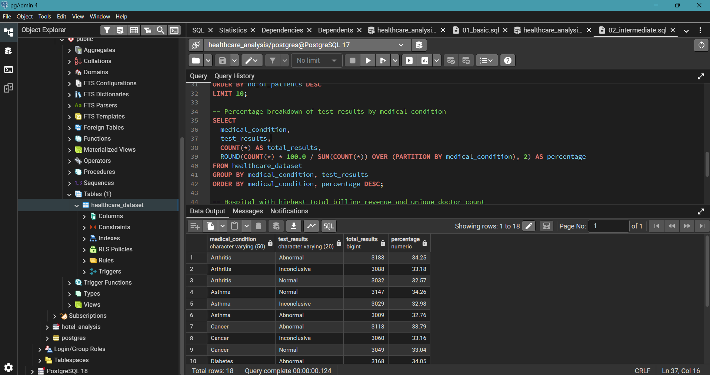
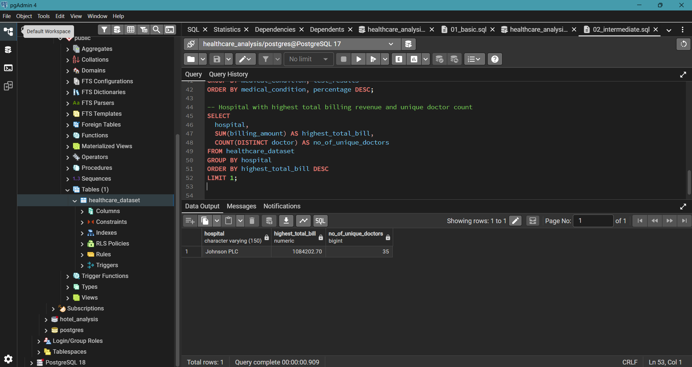

# Healthcare Patient Records: SQL Analysis

**Which conditions, hospitals, and patients drive cost, length of stay, and readmission risk?** A PostgreSQL analysis of 55,500 synthetic patient records covering billing patterns, length of stay, doctor performance, cost segmentation, and a rule-based readmission risk score.

**Tools:** PostgreSQL · pgAdmin 4 · SQL (CTEs, window functions, `CASE WHEN`, date functions)

---

## Business Context

Hospital operations and finance teams need to know where cost and patient volume concentrate, which conditions strain bed capacity, which bills look unusual, and which patients need follow-up care first. This project answers those questions using SQL alone, moving from basic aggregation to multi-step CTEs and window functions.

## Project Objective

Answer four business questions:

1. Which medical conditions, doctors, and hospitals drive the most cost and patient volume?
2. How does length of stay vary across conditions, and what is associated with a longer stay?
3. Which patients are billing outliers relative to others with the same condition?
4. Which patients can be flagged as **high readmission risk** based on admission type, test results, and length of stay?

---

## Key Findings and Recommendations

| # | Finding | So What? |
|---|---|---|
| 1 | **Test results are evenly distributed.** Within each of the six medical conditions, Normal, Abnormal, and Inconclusive results each account for roughly one-third of records (about 32% to 35%). For example, Arthritis splits 34.25% Abnormal, 33.18% Inconclusive, and 32.57% Normal. | Test result alone does not separate patients well. It needs to be combined with admission type and stay length to be useful for risk flagging. |
| 2 | **Johnson PLC has the highest total billing** at 1,084,202.70, across 35 unique doctors. | This is the top hospital by revenue. Comparing it with the runners-up, and checking whether volume or per-patient billing drives the total, is the natural next step for finance and operations teams. |
| 3 | **Length of stay is nearly identical across conditions.** Average stay ranges only from 15.4 days (Diabetes) to 15.7 days (Asthma), a spread of 0.3 days. | Condition is not a useful basis for capacity planning in this data. Any bed-planning or risk logic would need to look at other factors, such as admission type or age. |
| 4 | **The highest bills are about twice their condition's average.** The largest overages in the output are roughly 2.0x to 2.1x the condition average. For example, a Hypertension patient was billed 52,764.28 against a condition average of 25,497.10, which is 27,267.18 above it. | These bills warrant review for billing accuracy or genuine case complexity before they are treated as errors. |
| 5 | **The risk score flags 3,064 patients (5.5%) as High Risk**: Emergency admission, Abnormal test result, and above-average stay. A further 3,027 (5.5%) are Medium Risk, and 49,409 (89.0%) are Low Risk. | Care teams could prioritize the High Risk group for follow-up outreach, about 1 in 18 patients. Because the score is rule-based and unvalidated (see Limitations), treat it as a starting point for review, not a prediction. |

---

## Repository Structure

```
Healthcare-Patient-SQL-Analysis/
├── queries/
│   ├── 01_basic.sql           # SELECT, GROUP BY, WHERE
│   ├── 02_intermediate.sql    # CTEs, CASE WHEN, date math
│   └── 03_advanced.sql        # Window functions, RFM-style segmentation, risk scoring
├── results/
│   ├── q9_test_results.png
│   ├── q10_hospital_revenue.png
│   └── q16_risk_score.png
└── README.md
```

---

## Dataset

**Source:** Kaggle, [Healthcare Dataset](https://www.kaggle.com/datasets/prasad22/healthcare-dataset) (synthetic data)

| Detail | Info |
|---|---|
| Rows | 55,500 patient records |
| Columns | 15 |
| Key fields | Age, Gender, Blood Type, Medical Condition, Admission/Discharge Date, Doctor, Hospital, Insurance Provider, Billing Amount, Admission Type, Test Results |
| Medical conditions | 6 (Arthritis, Asthma, Cancer, Diabetes, Hypertension, Obesity) |
| Tool used | PostgreSQL via pgAdmin 4 |

---

## SQL Skills Demonstrated

| Skill | Where it is used |
|---|---|
| Aggregate functions | `COUNT`, `SUM`, `AVG`, `ROUND` throughout |
| Conditional logic | `CASE WHEN` for age brackets, trend labeling, and risk scoring |
| CTEs (multi-step) | Nested `WITH` clauses for ranking, outlier detection, and cost segmentation |
| Window functions | `RANK() OVER`, `LAG() OVER`, `NTILE() OVER`, `SUM() OVER` |
| Date functions | `DATE_TRUNC()` for monthly trends, direct date subtraction for length of stay |
| Outlier detection | Threshold-based filtering against group averages |
| Risk scoring | Multi-condition `CASE WHEN` combined with `CROSS JOIN` |
| Query optimization | Refactoring repeated window function calls into a single computed column |

---

## Selected Results

### Test result breakdown by medical condition (Q9)

Uses `SUM(COUNT(*)) OVER (PARTITION BY medical_condition)` to calculate each result's share within its condition.



### Highest-billing hospital (Q10)



### Average length of stay by medical condition

| Medical condition | Avg. stay (days) |
|---|---|
| Asthma | 15.7 |
| Arthritis | 15.5 |
| Hypertension | 15.5 |
| Obesity | 15.5 |
| Cancer | 15.5 |
| Diabetes | 15.4 |

### Patients billed above their condition's average (top overages)

A CTE calculates each condition's average billing amount, then the main query compares every patient's bill against it.

| Medical condition | Billing amount | Condition avg. | Amount above avg. |
|---|---|---|---|
| Hypertension | 52,764.28 | 25,497.10 | 27,267.18 |
| Cancer | 52,373.03 | 25,161.79 | 27,211.24 |
| Cancer | 52,154.24 | 25,161.79 | 26,992.45 |

---

## Featured Query: Readmission Risk Score

A rule-based score that flags a patient as **High Risk** when the admission was an Emergency, the test result was Abnormal, and the stay was longer than the dataset average (about 15.5 days). Emergency and Abnormal patients with a shorter stay are **Medium Risk**, and all others are **Low Risk**.

```sql
WITH stay_avg AS (
  SELECT ROUND(AVG(discharge_date - date_of_admission), 1) AS avg_stay
  FROM healthcare_dataset
),
patient_risk AS (
  SELECT
    h.name,
    h.medical_condition,
    h.admission_type,
    h.test_results,
    (h.discharge_date - h.date_of_admission) AS stay_length,
    CASE
      WHEN h.admission_type = 'Emergency'
        AND h.test_results = 'Abnormal'
        AND (h.discharge_date - h.date_of_admission) > s.avg_stay
      THEN 'High Risk'
      WHEN h.admission_type = 'Emergency'
        AND h.test_results = 'Abnormal'
      THEN 'Medium Risk'
      ELSE 'Low Risk'
    END AS readmission_risk
  FROM healthcare_dataset h
  CROSS JOIN stay_avg s
)
SELECT
  readmission_risk,
  COUNT(*) AS patient_count,
  ROUND(COUNT(*) * 100.0 / SUM(COUNT(*)) OVER (), 1) AS pct_of_total
FROM patient_risk
GROUP BY readmission_risk
ORDER BY patient_count DESC;
```

**Output**

| Readmission risk | Patients | % of total |
|---|---|---|
| Low Risk | 49,409 | 89.0% |
| High Risk | 3,064 | 5.5% |
| Medium Risk | 3,027 | 5.5% |


The full set of 16 queries is in the `queries/` folder, organized by difficulty level.

---

## Limitations

- **Synthetic data.** The dataset is simulated, so findings demonstrate SQL technique and analytical approach, not real clinical or financial patterns. Patient, doctor, and hospital names are generated, not real.
- **Data quality issues in the raw data.** Patient names have inconsistent capitalization (e.g., "tOdd CARrILIO"), and the billing-outlier output contains at least one apparent duplicate record (same name, condition, and billing amount appears twice). Results reflect the table as imported, so counts may include duplicates.
- **No unique patient ID.** Repeat-patient analysis (e.g., Q14) relies on name matching, which cannot confirm true patient identity. Treat it as a technique demonstration, not a valid finding.
- **The risk score is not validated.** The dataset has no actual readmission outcome, so the score cannot be tested against real readmissions. The rules are a hand-built heuristic.
- **The stay threshold splits the group almost in half.** High Risk (3,064) and Medium Risk (3,027) are nearly equal, which suggests the average-stay cutoff divides the Emergency and Abnormal group roughly in two rather than isolating a distinct cohort. On real data, a clinically informed threshold would be needed.
- **Unusually uniform patterns.** Test results split roughly one-third each in every condition, average stay differs by only 0.3 days across conditions, and average billing is similar across conditions (about 25,000 to 25,500). This is typical of simulated data and would be unusual in real patient populations.
- **Outlier definition is simple.** The 1.5x group-average threshold is easy to explain but ignores spread within each condition. A standard-deviation-based method would be more robust.
- **Association, not causation.** Patterns in length of stay and billing show relationships in the data, not their causes.

---

## How to Run This Project

**Prerequisites:** PostgreSQL and pgAdmin 4.

1. Create a new database named `healthcare_analysis`.
2. Run the `CREATE TABLE healthcare_dataset (...)` statement included in `01_basic.sql`.
3. Import `healthcare_dataset.csv` using pgAdmin's Import/Export Data tool.
4. Run the queries in the `queries/` folder in order: basic, intermediate, advanced.

---

## What I Learned

- `COUNT(column)` and `COUNT(DISTINCT column)` return different results, and using the wrong one silently inflates numbers without raising an error.
- A column alias created in a `CASE WHEN` cannot be reused in another `CASE WHEN` in `ORDER BY` after a `GROUP BY`. Carrying a numeric sort key through the grouping solves it.
- `QUALIFY` (Snowflake/BigQuery) is not supported in PostgreSQL. The workaround is to wrap the window function in a CTE and filter in an outer query.
- A simple multiplier-based outlier threshold (e.g., 1.5x the average) is easy to explain, while a standard-deviation-based approach is more statistically grounded. The right choice depends on the audience and the data.
- Repeated window function calls (e.g., `LAG()` called four times in one query) should be refactored into a single computed column for cleaner, more efficient SQL.
- Synthetic datasets without a unique patient ID limit the validity of "repeat visit" analysis, so data limitations should be stated rather than glossed over.

---

## About

Built by **Atharv Dhole** as a data analytics portfolio project.

- LinkedIn: https://www.linkedin.com/in/atharv-dhole/
- Email: atharvdhole22@gmail.com
