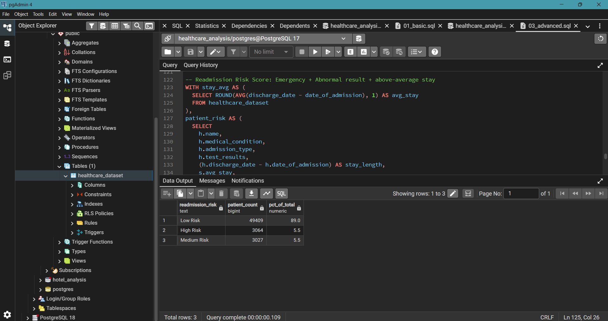

# Healthcare Patient Records — SQL Analysis

A comprehensive SQL analysis of 10,000 synthetic patient records using PostgreSQL, covering billing patterns, length of stay, doctor performance, cost segmentation, and a custom-built readmission risk scoring system.

---

## Project Objective

To analyse patient and hospital data to answer key healthcare analytics questions:
- Which medical conditions, doctors, and hospitals drive the most cost and patient volume?
- How does length of stay vary across conditions, and what predicts a longer stay?
- Which patients are billing outliers relative to others with the same condition?
- Which patients can be flagged as **high readmission risk** based on admission type, test results, and stay length?

---

## Repository Structure

```
📂 Healthcare-Patient-SQL-Analysis/
├── 📂 queries/
│   ├── 01_basic.sql           ← SELECT, GROUP BY, WHERE
│   ├── 02_intermediate.sql    ← CTEs, CASE WHEN, date math
│   └── 03_advanced.sql        ← Window functions, RFM-style segmentation, risk scoring
├── 📂 results/
│   ├── q9_test_results.png
│   ├── q10_hospital_revenue.png
│   └── q16_risk_score.png
└── README.md
```

---

## Dataset

**Source:** Kaggle — [Healthcare Dataset](https://www.kaggle.com/datasets/prasad22/healthcare-dataset)

| Detail | Info |
|---|---|
| Rows | ~10,000 patient records |
| Columns | 15 |
| Key fields | Age, Gender, Blood Type, Medical Condition, Admission/Discharge Date, Doctor, Hospital, Insurance Provider, Billing Amount, Admission Type, Test Results |
| Tool used | PostgreSQL via pgAdmin 4 |

> Note: Patient names in this dataset are synthetically generated. Any analysis involving repeat-patient identification (e.g. Q14) should be read as a SQL technique demonstration rather than a clinically valid finding, since name matching cannot confirm true patient identity without a unique patient ID.

---

## Key Findings

1. **Test result distribution is fairly balanced** — Normal, Abnormal, and Inconclusive results are spread close to evenly across the dataset, with no single result type dominating.
2. **One hospital significantly outpaces others in total billing revenue** — driven by both higher patient volume and a broader base of unique doctors.
3. **Length of stay varies meaningfully by medical condition** — some conditions consistently require longer average hospital stays than others, useful for capacity planning.
4. **Billing outliers exist within every condition group** — a subset of patients are billed 50%+ above the average for their specific condition, worth investigating for billing accuracy or case complexity.
5. **Readmission Risk Scoring identifies a clear high-risk segment** — patients with an Emergency admission type, an Abnormal test result, and an above-average length of stay form a distinct group that hospitals could prioritize for follow-up care.

---

## SQL Skills Demonstrated

| Skill | Where it's used |
|---|---|
| Aggregate functions | `COUNT`, `SUM`, `AVG`, `ROUND` throughout |
| Conditional logic | `CASE WHEN` for age brackets, trend labeling, risk scoring |
| CTEs (multi-step) | Nested `WITH` clauses for ranking, outlier detection, cost segmentation |
| Window functions | `RANK() OVER`, `LAG() OVER`, `NTILE() OVER`, `SUM() OVER` |
| Date functions | `DATE_TRUNC()` for monthly trends, direct date subtraction for length of stay |
| Outlier detection | Threshold-based filtering against group averages |
| Risk scoring | Multi-condition `CASE WHEN` combined with `CROSS JOIN` |
| Query optimization | Identifying and refactoring repeated window function calls |

---

## Featured Query — Readmission Risk Score

```sql
WITH stay_avg AS (
  SELECT ROUND(AVG(discharge_date - date_of_admission), 1) AS avg_stay
  FROM healthcare_dataset
),
patient_risk AS (
  SELECT
    h.name,
    h.medical_condition,
    h.admission_type,
    h.test_results,
    (h.discharge_date - h.date_of_admission) AS stay_length,
    CASE
      WHEN h.admission_type = 'Emergency'
        AND h.test_results = 'Abnormal'
        AND (h.discharge_date - h.date_of_admission) > s.avg_stay
      THEN 'High Risk'
      WHEN h.admission_type = 'Emergency'
        AND h.test_results = 'Abnormal'
      THEN 'Medium Risk'
      ELSE 'Low Risk'
    END AS readmission_risk
  FROM healthcare_dataset h
  CROSS JOIN stay_avg s
)
SELECT
  readmission_risk,
  COUNT(*) AS patient_count,
  ROUND(COUNT(*) * 100.0 / SUM(COUNT(*)) OVER (), 1) AS pct_of_total
FROM patient_risk
GROUP BY readmission_risk
ORDER BY patient_count DESC;
```



> Full set of 16 queries available in the `queries/` folder, organised by difficulty level.

---

## How to Run This Project

1. Install **PostgreSQL** and **pgAdmin 4**
2. Create a new database: `healthcare_analysis`
3. Run the `CREATE TABLE healthcare_dataset (...)` statement (included in `01_basic.sql`)
4. Import `healthcare_dataset.csv` via pgAdmin's Import/Export Data tool
5. Execute queries from the `queries/` folder in order — basic → intermediate → advanced

---

## What I Learned

- The distinction between `COUNT(column)` and `COUNT(DISTINCT column)` — and how using the wrong one silently inflates results without throwing an error.
- Why a column alias created via `CASE WHEN` cannot be reused inside another `CASE WHEN` in `ORDER BY` after a `GROUP BY` — and how to solve it by carrying a numeric sort key through the grouping instead of re-deriving it.
- That `QUALIFY` (used in Snowflake/BigQuery) is not supported in PostgreSQL, and the standard workaround is wrapping a window function in a CTE, then filtering on it in an outer query.
- The tradeoff between a simple multiplier-based outlier threshold (e.g. 1.5× the average) versus a statistically grounded standard-deviation-based approach, and when each is appropriate.
- How to recognise and refactor repeated window function calls (`LAG()` called 4 times in one query) into a single computed column for cleaner, more efficient SQL.
- Why synthetic datasets without a unique patient ID limit the validity of "repeat visit" analysis — and the importance of noting data limitations rather than overstating findings.

---

## About

Built by **Atharv Dhole** as part of a data analyst portfolio project.

- 🔗 LinkedIn: https://www.linkedin.com/in/atharv-dhole/
- 📧 Email: atharvdhole22@gmail.com

---

